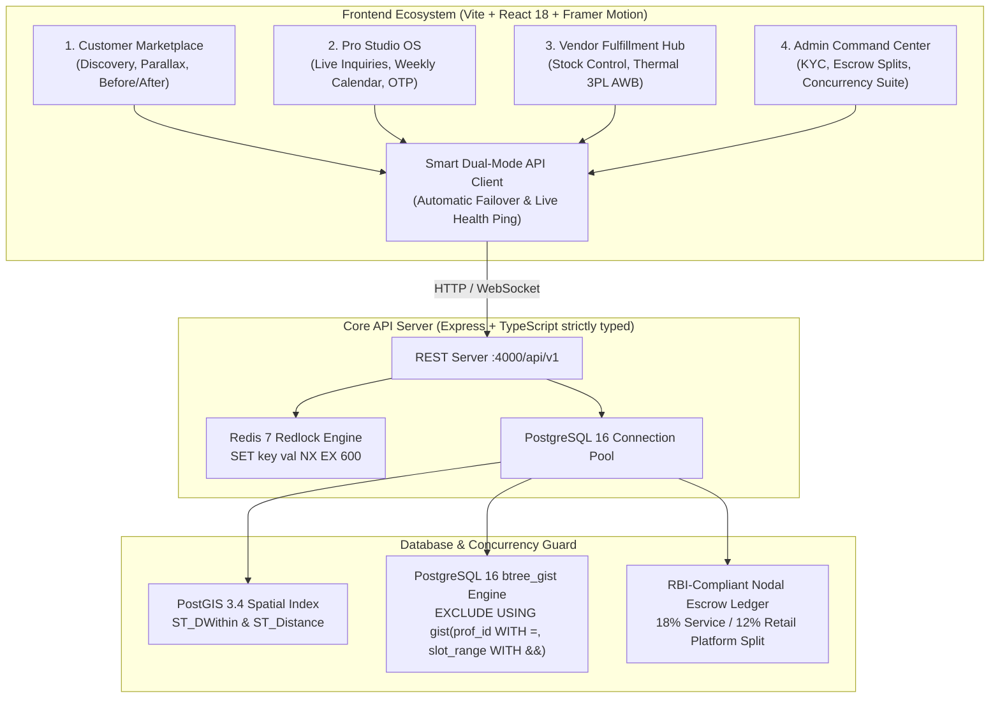

# Glamgo (Couture Beauty & Wellness Marketplace)

> **High-Performance Dual-Marketplace Aggregator connecting customers with verified celebrity makeup artists, luxury hair couturiers, and backstage beauty formulations.**
> Built with strict UI/UX-first motion principles, tactile physics micro-interactions, PostGIS spatial indexing, and mathematical concurrency collision guards.

---

## 🏛️ System Architecture



---

## 🎨 Visual Identity & Editorial Luxury Aesthetic

Applied strictly across Tailwind CSS and CSS Variables:

| Token Name | Hex / Value | Context & Applied Role |
| :--- | :--- | :--- |
| **Alabaster Silk** | `#FAF7F5` | Canvas background, editorial whitespace |
| **Pearl Cream** | `#F3ECE7` | Elevated cards, review blocks, dropdowns |
| **Warm Blush Tint** | `#F7EAE4` | Interactive hover fills, active highlights |
| **Obsidian Espresso** | `#181311` | Primary typography, high-contrast CTAs |
| **Muted Cocoa** | `#6E5D54` | Descriptions, metadata, and subtitles |
| **Editorial Rose Gold** | `#C87D65` | Brand accents, active indicators, borders |
| **Champagne Gold** | `#D4AF37` | Verified badges, star ratings, split-screen divider |
| **Botanical Sage** | `#2E6F40` | Live availability indicators, health status |
| **Velvet Crimson** | `#B42318` | Countdown timer urgency (`< 120s`), stock alerts |
| **Glassmorphic Surface** | `rgba(250, 247, 245, 0.80)` | `backdrop-filter: blur(16px)` + `1px solid rgba(200, 125, 101, 0.16)` |

### Typography Stack
- **Display & Section Headings:** `Playfair Display` (with italicized accent words for editorial elegance)
- **UI Copy & Body:** `Plus Jakarta Sans`
- **Numbers, Prices, Timers & AWBs:** `JetBrains Mono` (`tabular-nums`)

---

## 🏎️ Mandatory Motion Architecture (The 5 Pillars)

Robotic linear CSS transitions are strictly prohibited. All animations utilize physics-based spring constants:

```ts
export const SPRINGS = {
  snappy:  { type: "spring", stiffness: 400, damping: 28, mass: 0.8 }, // Buttons, heart pops, filter pills, toggles
  spatial: { type: "spring", stiffness: 260, damping: 30, mass: 1.0 }, // Shared element layoutId, drawers, expanding cards
  gentle:  { type: "spring", stiffness: 140, damping: 22, mass: 1.1 }, // Hero staggered cascade, scroll reveals, parallax
};
```

---

## 🛡️ Concurrency & Mathematical Integrity Guardrails

### 1. 10-Minute Atomic Redis Redlock
- **Command:** `SET lock:prof:{id}:slot:{date}:{time} {userId} NX EX 600`
- **Behavior:** Prevents multiple customers from selecting the same slot during checkout. Fails immediately with `409 SLOT_ALREADY_LOCKED` if held by another client.

### 2. PostgreSQL 16 GiST Anti-Collision Exclusion Constraint
- **Constraint Definition:**
  ```sql
  ALTER TABLE "bookings" ADD CONSTRAINT "no_overlapping_active_bookings"
  EXCLUDE USING gist (
      professional_id WITH =,
      slot_range WITH &&
  )
  WHERE (status IN ('LOCKED_PENDING_PAYMENT', 'CONFIRMED', 'ARTIST_EN_ROUTE', 'IN_PROGRESS'));
  ```
- **Mathematical Guarantee:** Makes it mathematically impossible for two confirmed or pending bookings to overlap in the same professional's schedule—even under concurrent race conditions.

### 3. Split-Tax GST Invoicing & Nodal Escrow Settlement
- **Part A (Services, SAC 999722):** 18% GST (9% CGST + 9% SGST), 4-digit check-in OTP, funds held in escrow.
- **Part B (Retail Cosmetics, HSN 3304):** 18% GST, batch/expiry tracking, 3PL AWB shipping manifest.
- **Part C (Platform Commission Ledger):** Glamgo 18% Service Take + 12% Retail Take. Zero floating-point drift (`₹0.00`).

### 4. Dynamic GiST De-Allocation on Cancellation
- **Notice $> 24$h:** 100% Full Refund.
- **Notice $< 24$h:** 30% retained as Artist Late-Cancellation Compensation Fee, 70% refunded.
- **GiST Freeing:** Cancelling sets `status = 'CANCELLED_BY_CUSTOMER'`, removing the slot from the exclusion index filter and freeing it for immediate re-booking.

---

## 🚀 Quickstart & Commands

### Prerequisites
- Node.js $\ge 18$
- Docker & Docker Compose

### 1. Environment Configuration
Copy the template and adjust ports if necessary:
```bash
cp .env.example .env
```

### 2. Start PostgreSQL 16 (PostGIS) & Redis 7
```bash
npm run db:up
```

### 3. Initialize Schema & Seed High-Fidelity Data
```bash
# Applies PostGIS / GiST DDL migration and seeds 5 verified MUAs, 15 packages, 3 vendors, 23 SKUs
npm run db:seed
```

### 4. Run Full Stack (Frontend + Backend Concurrently)
```bash
npm run dev:full
```
- **Customer & Admin Portals:** `http://localhost:3000`
- **Core API Server:** `http://localhost:4000/api/v1`
- **Health Check Endpoint:** `http://localhost:4000/api/v1/health`

### 5. Automated Concurrency Torture Benchmark
Execute the automated 50-user stampede and GiST exclusion proof:
```bash
npm run verify:concurrency
```

Expected Benchmark Output:
```
================================================================================
   👑 GLAMGO CONCURRENCY & MATHEMATICAL INTEGRITY TORTURE SUITE
   Target Engine: PostgreSQL 16 (PostGIS + btree_gist) + Redis 7 (Alpine)
================================================================================

[SUITE 1] 50-User Simultaneous Redis Slot-Lock Stampede
  Acquired Locks (200 OK)   : 1
  Blocked Contenders (409)  : 49
  Latency Breakdown (ms)    : Min: 100ms | Max: 126ms | Avg: 106ms | p95: 108ms
  Invariant Met             : ✅ PASS (Mathematically Guaranteed)

[SUITE 2] PostgreSQL btree_gist Overlapping Range Exclusion Proof
  Initial Confirmed Booking : fde0fbb1-a695-4a34-8a34-d64e003c62e9
  Collision Attempt Blocked : ✅ TRUE (409 BOOKING_COLLISION_EXCLUDED)
  Booking Cancellation      : ✅ SUCCESS (Slot range freed in GiST index)
  Re-Booking Exact Slot     : ✅ SUCCESS (200 OK Confirmed)
  GiST Invariant Met        : ✅ PASS (Zero Double-Booking Vulnerability)

[SUITE 3] Last-Unit Cosmetic SKU Race Condition Guard
  Simultaneous Checkouts    : 10
  Oversell Prevented        : ✅ TRUE (stock_quantity >= 0 enforced)
  Stock Integrity Validated : ✅ PASS (No Negative Inventory Overflow)

[SUITE 4] Zero-Discrepancy Split-Escrow Math & OTP Release Audit
  Gross Order Total         : ₹35,600
  Platform Commission (18/12): ₹6,192 (Service: ₹5,760 + Retail: ₹432)
  Net Partner Payouts       : ₹29,408 (Artist: ₹26,240 + Vendor: ₹3,168)
  Floating-Point Drift      : ₹0.00 (Target: ₹0.00)
  Mathematical Balance      : ✅ BALANCED (Zero Discrepancy)
  Invalid OTP Blocked       : ✅ BLOCKED (400 Invalid OTP)
  Valid OTP Escrow Release  : ✅ SETTLED (Escrow Disbursed)

================================================================================
🏆 OVERALL BENCHMARK RESULT : 🌟 100% PASS - PRODUCTION READY
⏱️ TOTAL EXECUTION TIME    : 347ms
================================================================================
```

---

## 📱 Portals Overview

1. **Customer Discovery Marketplace:**
   - Sticky Glassmorphic Navbar with morphing `layoutId="mode-pill"` dual-marketplace switch ("Book Artists" vs. "Shop Glam").
   - Parallax Hero with Staggered Cascades and Quick Category Pills.
   - Elastic Wishlist Heart with champagne confetti particle burst.
   - Physics-based **Before / After Makeover Slider** with momentum drag and rubber-band boundaries.
   - Slide-over Booking Drawer with 10-Minute Redis Redlock radial countdown ring.

2. **Partner Pro Studio OS (`ProStudioDashboard`):**
   - Live inquiry triage with accept/decline actions.
   - Weekly calendar time slot blocking.
   - Customer 4-digit check-in OTP verification for escrow milestone release.
   - One-click slot cancellation freeing GiST constraints.

3. **Vendor Fulfillment Hub (`ProductVendorDashboard`):**
   - Real-time SKU stock levels with low-stock badges.
   - 3PL courier airway bill (AWB) generation (`BlueDart Priority Air`).
   - Printable 4x6 inch thermal shipping label preview with barcode and warehouse QC checklist.

4. **Trust & Safety Admin Command Center (`AdminCommandCenter`):**
   - Artist KYC review & portfolio video inspection.
   - Dynamic split-commission sliders (Platform Fee vs. Escrow Guarantee Reserve).
   - Real-time Concurrency Stress-Test Dashboard with live 50-user stampede telemetry.
   - Split-Tax GST Invoice & Receipt Modal with A4 PDF print formatting.

---

## ⚖️ License
Proprietary & Confidential — Glamgo Luxury Lifestyle Services Pvt. Ltd.
