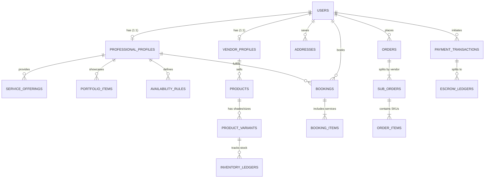

# Database Architecture & Schema Specification: Glamgo

## 1. Database Engine & Extensions
Glamgo uses **PostgreSQL 16** as the primary system of record, leveraging:
- **`uuid-ossp` / `pgcrypto`:** For UUIDv7 (time-ordered) primary keys.
- **`postgis`:** For accurate geospatial distance calculations and radius filtering of beauty professionals and studios.
- **`btree_gist`:** For database-level exclusion constraints that make double-booking mathematically impossible at the storage layer.

---

## 2. Entity-Relationship Diagram (ERD)



---

## 3. Core DDL Schema Definitions

### 3.1 Identity, Roles & Profiles

```sql
CREATE EXTENSION IF NOT EXISTS "postgis";
CREATE EXTENSION IF NOT EXISTS "btree_gist";

CREATE TYPE user_role AS ENUM ('CUSTOMER', 'PROFESSIONAL', 'VENDOR', 'ADMIN');
CREATE TYPE kyc_status AS ENUM ('PENDING', 'UNDER_REVIEW', 'APPROVED', 'REJECTED', 'SUSPENDED');
CREATE TYPE service_location_mode AS ENUM ('AT_VENUE', 'IN_STUDIO', 'BOTH');

CREATE TABLE users (
    id UUID PRIMARY KEY DEFAULT gen_random_uuid(),
    phone VARCHAR(20) UNIQUE NOT NULL,
    email VARCHAR(255) UNIQUE,
    full_name VARCHAR(150) NOT NULL,
    avatar_url TEXT,
    roles user_role[] DEFAULT '{CUSTOMER}',
    is_active BOOLEAN DEFAULT TRUE,
    created_at TIMESTAMPTZ NOT NULL DEFAULT NOW(),
    updated_at TIMESTAMPTZ NOT NULL DEFAULT NOW()
);

CREATE TABLE professional_profiles (
    id UUID PRIMARY KEY DEFAULT gen_random_uuid(),
    user_id UUID UNIQUE NOT NULL REFERENCES users(id) ON DELETE CASCADE,
    slug VARCHAR(180) UNIQUE NOT NULL,
    business_name VARCHAR(200) NOT NULL,
    bio TEXT,
    experience_years INT DEFAULT 0,
    specialties TEXT[] NOT NULL, -- e.g., {'Bridal Makeup', 'Hairstyling', 'Nail Art'}
    service_mode service_location_mode NOT NULL DEFAULT 'BOTH',
    studio_location GEOGRAPHY(Point, 4326),
    studio_address JSONB,
    max_travel_radius_km NUMERIC(5, 2) DEFAULT 25.00,
    travel_fee_per_km NUMERIC(10, 2) DEFAULT 0.00,
    kyc_status kyc_status NOT NULL DEFAULT 'PENDING',
    rating_avg NUMERIC(3, 2) DEFAULT 0.00,
    review_count INT DEFAULT 0,
    commission_rate_pct NUMERIC(5, 2) DEFAULT 20.00,
    created_at TIMESTAMPTZ NOT NULL DEFAULT NOW(),
    updated_at TIMESTAMPTZ NOT NULL DEFAULT NOW()
);

CREATE INDEX idx_pro_studio_location ON professional_profiles USING GIST (studio_location);
CREATE INDEX idx_pro_specialties ON professional_profiles USING GIN (specialties);

CREATE TABLE vendor_profiles (
    id UUID PRIMARY KEY DEFAULT gen_random_uuid(),
    user_id UUID UNIQUE NOT NULL REFERENCES users(id) ON DELETE CASCADE,
    brand_name VARCHAR(200) NOT NULL,
    slug VARCHAR(180) UNIQUE NOT NULL,
    gstin_or_tax_id VARCHAR(50) UNIQUE NOT NULL,
    warehouse_address JSONB NOT NULL,
    kyc_status kyc_status NOT NULL DEFAULT 'PENDING',
    commission_rate_pct NUMERIC(5, 2) DEFAULT 15.00,
    created_at TIMESTAMPTZ NOT NULL DEFAULT NOW()
);
```

### 3.2 Services, Portfolios & Scheduling Engine

```sql
CREATE TABLE service_offerings (
    id UUID PRIMARY KEY DEFAULT gen_random_uuid(),
    professional_id UUID NOT NULL REFERENCES professional_profiles(id) ON DELETE CASCADE,
    category VARCHAR(100) NOT NULL, -- e.g., 'Bridal', 'Party Makeup', 'Skincare'
    title VARCHAR(200) NOT NULL,
    description TEXT,
    products_used TEXT[], -- e.g., {'MAC', 'NARS', 'Huda Beauty'}
    duration_minutes INT NOT NULL CHECK (duration_minutes >= 15),
    buffer_minutes INT NOT NULL DEFAULT 30,
    base_price NUMERIC(12, 2) NOT NULL,
    deposit_pct NUMERIC(5, 2) NOT NULL DEFAULT 30.00,
    is_addon BOOLEAN DEFAULT FALSE,
    is_active BOOLEAN DEFAULT TRUE,
    created_at TIMESTAMPTZ NOT NULL DEFAULT NOW()
);

CREATE TABLE portfolio_items (
    id UUID PRIMARY KEY DEFAULT gen_random_uuid(),
    professional_id UUID NOT NULL REFERENCES professional_profiles(id) ON DELETE CASCADE,
    media_type VARCHAR(20) NOT NULL CHECK (media_type IN ('IMAGE', 'VIDEO')),
    media_url TEXT NOT NULL,
    thumbnail_url TEXT,
    occasion_tag VARCHAR(80), -- e.g., 'South Indian Bridal', 'Editorial', 'Reception'
     tagged_variant_ids UUID[], -- Links portfolio looks to shoppable product variants
    created_at TIMESTAMPTZ NOT NULL DEFAULT NOW()
);

CREATE TABLE availability_rules (
    id UUID PRIMARY KEY DEFAULT gen_random_uuid(),
    professional_id UUID NOT NULL REFERENCES professional_profiles(id) ON DELETE CASCADE,
    day_of_week SMALLINT CHECK (day_of_week BETWEEN 0 AND 6), -- 0 = Sunday
    start_time TIME NOT NULL,
    end_time TIME NOT NULL,
    is_day_off BOOLEAN DEFAULT FALSE,
    UNIQUE (professional_id, day_of_week)
);

CREATE TYPE booking_status AS ENUM (
    'LOCKED_PENDING_PAYMENT',
    'CONFIRMED',
    'ARTIST_EN_ROUTE',
    'IN_PROGRESS',
    'COMPLETED',
    'CANCELLED_BY_CUSTOMER',
    'CANCELLED_BY_PRO',
    'DISPUTED',
    'EXPIRED'
);

CREATE TABLE bookings (
    id UUID PRIMARY KEY DEFAULT gen_random_uuid(),
    booking_number VARCHAR(30) UNIQUE NOT NULL,
    customer_id UUID NOT NULL REFERENCES users(id),
    professional_id UUID NOT NULL REFERENCES professional_profiles(id),
    status booking_status NOT NULL DEFAULT 'LOCKED_PENDING_PAYMENT',
    service_mode service_location_mode NOT NULL,
    venue_address JSONB,
    venue_location GEOGRAPHY(Point, 4326),
    slot_start TIMESTAMPTZ NOT NULL,
    slot_end TIMESTAMPTZ NOT NULL,
    lock_expires_at TIMESTAMPTZ,
    subtotal_amount NUMERIC(12, 2) NOT NULL,
    travel_fee NUMERIC(12, 2) NOT NULL DEFAULT 0.00,
    tax_amount NUMERIC(12, 2) NOT NULL DEFAULT 0.00,
    total_amount NUMERIC(12, 2) NOT NULL,
    deposit_paid_amount NUMERIC(12, 2) NOT NULL DEFAULT 0.00,
    balance_due_amount NUMERIC(12, 2) NOT NULL DEFAULT 0.00,
    start_otp_hash VARCHAR(128),
    complete_otp_hash VARCHAR(128),
    created_at TIMESTAMPTZ NOT NULL DEFAULT NOW(),
    updated_at TIMESTAMPTZ NOT NULL DEFAULT NOW(),
    
    -- Strict DB-level exclusion constraint preventing overlapping active bookings
    CONSTRAINT no_overlapping_bookings EXCLUDE USING gist (
        professional_id WITH =,
        tstzrange(slot_start, slot_end, '[)') WITH &&
    ) WHERE (status IN ('LOCKED_PENDING_PAYMENT', 'CONFIRMED', 'ARTIST_EN_ROUTE', 'IN_PROGRESS'))
);

CREATE TABLE booking_items (
    id UUID PRIMARY KEY DEFAULT gen_random_uuid(),
    booking_id UUID NOT NULL REFERENCES bookings(id) ON DELETE CASCADE,
    service_offering_id UUID NOT NULL REFERENCES service_offerings(id),
    quantity INT NOT NULL DEFAULT 1,
    unit_price NUMERIC(12, 2) NOT NULL,
    duration_minutes INT NOT NULL
);
```

### 3.3 E-Commerce Catalog, Inventory & Orders

```sql
CREATE TABLE products (
    id UUID PRIMARY KEY DEFAULT gen_random_uuid(),
    vendor_id UUID NOT NULL REFERENCES vendor_profiles(id) ON DELETE CASCADE,
    slug VARCHAR(220) UNIQUE NOT NULL,
    title VARCHAR(250) NOT NULL,
    brand_name VARCHAR(150) NOT NULL,
    category_path VARCHAR(255) NOT NULL, -- e.g., 'Makeup/Face/Foundation'
    description TEXT NOT NULL,
    ingredients TEXT,
    is_pro_equipment BOOLEAN DEFAULT FALSE, -- Flag for professional beauty equipment
    b2b_only BOOLEAN DEFAULT FALSE,
    rating_avg NUMERIC(3, 2) DEFAULT 0.00,
    review_count INT DEFAULT 0,
    is_active BOOLEAN DEFAULT TRUE,
    created_at TIMESTAMPTZ NOT NULL DEFAULT NOW()
);

CREATE TABLE product_variants (
    id UUID PRIMARY KEY DEFAULT gen_random_uuid(),
    product_id UUID NOT NULL REFERENCES products(id) ON DELETE CASCADE,
    sku VARCHAR(100) UNIQUE NOT NULL,
    shade_name VARCHAR(100), -- e.g., 'NC42 Warm Sun'
    shade_hex CHAR(7),       -- e.g., '#D2996C'
    size_label VARCHAR(50),  -- e.g., '30ml'
    mrp_price NUMERIC(12, 2) NOT NULL,
    retail_price NUMERIC(12, 2) NOT NULL,
    pro_wholesale_price NUMERIC(12, 2), -- Special price for verified professionals
    stock_quantity INT NOT NULL DEFAULT 0 CHECK (stock_quantity >= 0),
    reserved_quantity INT NOT NULL DEFAULT 0 CHECK (reserved_quantity >= 0),
    batch_number VARCHAR(80),
    expiry_date DATE,
    images TEXT[] NOT NULL,
    updated_at TIMESTAMPTZ NOT NULL DEFAULT NOW()
);

CREATE TYPE order_status AS ENUM (
    'PENDING_PAYMENT', 'CONFIRMED', 'PACKED', 'SHIPPED', 'DELIVERED', 'CANCELLED', 'RETURN_REQUESTED', 'REFUNDED'
);

CREATE TABLE orders (
    id UUID PRIMARY KEY DEFAULT gen_random_uuid(),
    order_number VARCHAR(30) UNIQUE NOT NULL,
    customer_id UUID NOT NULL REFERENCES users(id),
    shipping_address JSONB NOT NULL,
    total_amount NUMERIC(12, 2) NOT NULL,
    discount_amount NUMERIC(12, 2) DEFAULT 0.00,
    tax_amount NUMERIC(12, 2) NOT NULL,
    net_payable NUMERIC(12, 2) NOT NULL,
    created_at TIMESTAMPTZ NOT NULL DEFAULT NOW()
);

CREATE TABLE sub_orders (
    id UUID PRIMARY KEY DEFAULT gen_random_uuid(),
    order_id UUID NOT NULL REFERENCES orders(id) ON DELETE CASCADE,
    vendor_id UUID NOT NULL REFERENCES vendor_profiles(id),
    status order_status NOT NULL DEFAULT 'PENDING_PAYMENT',
    awb_tracking_number VARCHAR(100),
    courier_partner VARCHAR(100),
    subtotal NUMERIC(12, 2) NOT NULL,
    delivered_at TIMESTAMPTZ,
    updated_at TIMESTAMPTZ NOT NULL DEFAULT NOW()
);

CREATE TABLE order_items (
    id UUID PRIMARY KEY DEFAULT gen_random_uuid(),
    sub_order_id UUID NOT NULL REFERENCES sub_orders(id) ON DELETE CASCADE,
    variant_id UUID NOT NULL REFERENCES product_variants(id),
    quantity INT NOT NULL CHECK (quantity > 0),
    unit_price NUMERIC(12, 2) NOT NULL,
    total_price NUMERIC(12, 2) NOT NULL
);
```

### 3.4 Payments, Escrow & Reviews

```sql
CREATE TYPE escrow_status AS ENUM ('HELD', 'ELIGIBLE_FOR_PAYOUT', 'SETTLED', 'REFUNDED', 'ON_HOLD_DISPUTE');

CREATE TABLE payment_transactions (
    id UUID PRIMARY KEY DEFAULT gen_random_uuid(),
    user_id UUID NOT NULL REFERENCES users(id),
    booking_id UUID REFERENCES bookings(id),
    order_id UUID REFERENCES orders(id),
    gateway_provider VARCHAR(50) NOT NULL, -- 'RAZORPAY' | 'STRIPE'
    gateway_order_id VARCHAR(150) UNIQUE NOT NULL,
    gateway_payment_id VARCHAR(150) UNIQUE,
    amount NUMERIC(12, 2) NOT NULL,
    currency CHAR(3) DEFAULT 'INR',
    status VARCHAR(40) NOT NULL, -- 'INITIATED', 'CAPTURED', 'FAILED', 'REFUNDED'
    created_at TIMESTAMPTZ NOT NULL DEFAULT NOW()
);

CREATE TABLE escrow_ledgers (
    id UUID PRIMARY KEY DEFAULT gen_random_uuid(),
    payment_transaction_id UUID NOT NULL REFERENCES payment_transactions(id),
    beneficiary_user_id UUID NOT NULL REFERENCES users(id), -- Pro or Vendor user_id
    booking_id UUID REFERENCES bookings(id),
    sub_order_id UUID REFERENCES sub_orders(id),
    gross_amount NUMERIC(12, 2) NOT NULL,
    platform_commission NUMERIC(12, 2) NOT NULL,
    tax_withheld NUMERIC(12, 2) NOT NULL DEFAULT 0.00,
    net_payout_amount NUMERIC(12, 2) NOT NULL,
    status escrow_status NOT NULL DEFAULT 'HELD',
    eligible_release_at TIMESTAMPTZ,
    settled_at TIMESTAMPTZ,
    payout_utr_reference VARCHAR(150),
    created_at TIMESTAMPTZ NOT NULL DEFAULT NOW()
);

CREATE TABLE reviews (
    id UUID PRIMARY KEY DEFAULT gen_random_uuid(),
    author_id UUID NOT NULL REFERENCES users(id),
    booking_id UUID UNIQUE REFERENCES bookings(id),
    order_item_id UUID UNIQUE REFERENCES order_items(id),
    professional_id UUID REFERENCES professional_profiles(id),
    product_id UUID REFERENCES products(id),
    rating SMALLINT NOT NULL CHECK (rating BETWEEN 1 AND 5),
    hygiene_rating SMALLINT CHECK (hygiene_rating BETWEEN 1 AND 5),
    punctuality_rating SMALLINT CHECK (punctuality_rating BETWEEN 1 AND 5),
    comment TEXT,
    media_urls TEXT[],
    is_verified BOOLEAN DEFAULT TRUE,
    created_at TIMESTAMPTZ NOT NULL DEFAULT NOW()
);
```

---

## 4. Indexing, Partitioning & Data Retention Strategy
1. **Geo-Spatial & Composite Indexing:**
   - `idx_pro_studio_location` (GIST) accelerates `ST_DWithin` queries to find professionals within a customer's city or travel radius in milliseconds.
   - `no_overlapping_bookings` (GIST on `professional_id` + `tstzrange`) guarantees atomic slot isolation even under concurrent checkout requests.
2. **Table Partitioning:**
   - `bookings`, `orders`, and `payment_transactions` are range-partitioned by `created_at` (quarterly partitions) to keep active working sets in RAM during peak wedding seasons.
3. **Read Replicas & Backup Policy:**
   - Read-heavy catalog and portfolio queries route to 2 read replicas; all slot locks, inventory decrements, and escrow ledger writes hit the primary node with Point-in-Time Recovery (PITR) and cross-region snapshots every 6 hours.